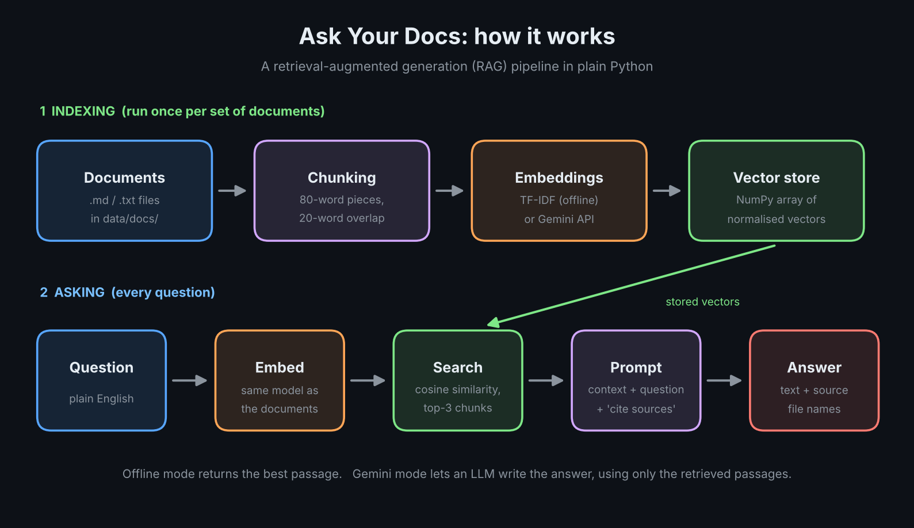
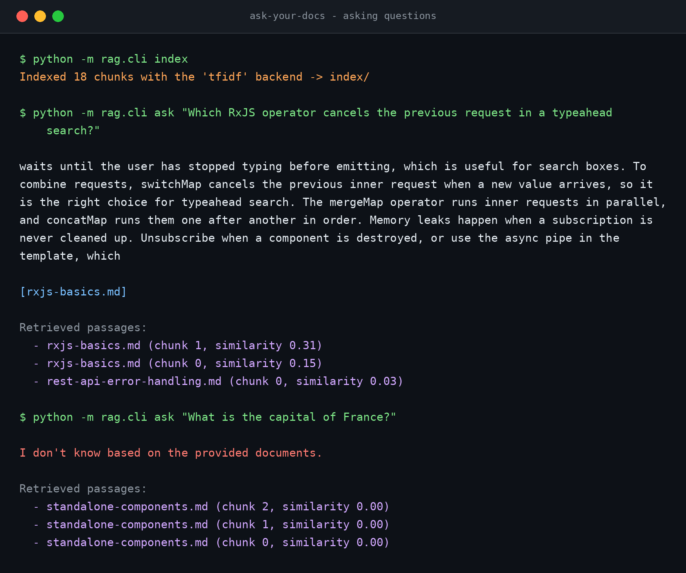
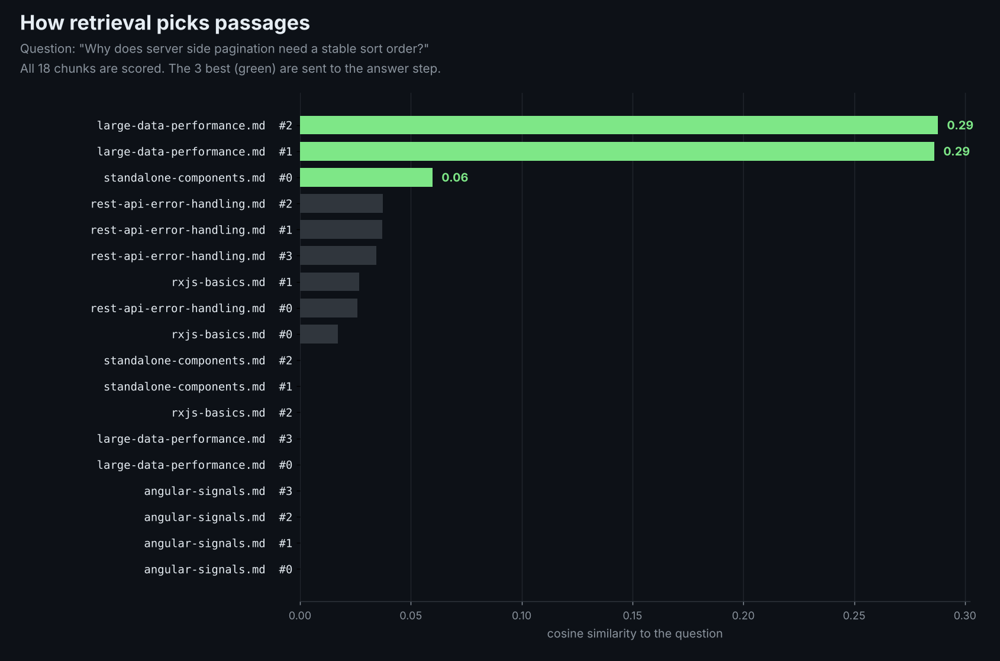
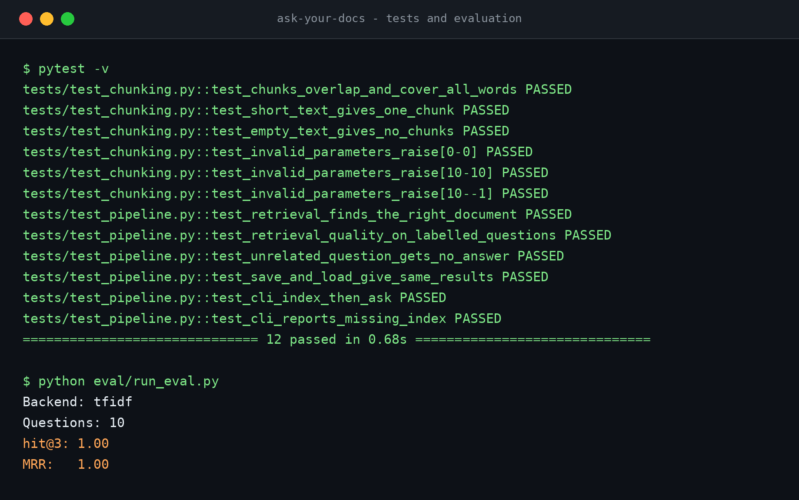

# Ask Your Docs

*Ask questions about your own documents in plain English and get answers with sources. Python RAG (retrieval-augmented generation) project, works offline or with the Gemini API.*

A small Python **retrieval-augmented generation (RAG)** tool. It reads your own Markdown or text files, finds the passages that match a question, and answers using only those passages, with sources.

It runs in two modes:

| Mode | Embeddings | Answer | Needs an API key |
|---|---|---|---|
| Offline (default) | TF-IDF (scikit-learn) | best matching passage | No |
| Gemini | Gemini embeddings | Gemini LLM writes the answer from the retrieved passages | Yes (`GEMINI_API_KEY`) |

The sample documents in `data/docs/` are short notes about Angular, RxJS, large-data performance and REST error handling.

## How it works



1. **Chunking** (`src/rag/chunking.py`): each document is split into overlapping word windows. The overlap keeps a sentence retrievable even when it falls on a chunk border.
2. **Embeddings** (`src/rag/embeddings.py`): text becomes a vector. TF-IDF matches keywords; Gemini embeddings match meaning, so they also find synonyms.
3. **Vector store** (`src/rag/store.py`): vectors are L2-normalised, so cosine similarity is one matrix-vector product. A NumPy array is enough for thousands of chunks.
4. **Generation** (`src/rag/generator.py`): the prompt tells the model to answer only from the context, to say "I don't know" otherwise, and to cite sources. This limits hallucination.
5. **Evaluation** (`eval/run_eval.py`): a labelled question set measures retrieval with hit@k and MRR, so changes to chunk size or the embedding model can be compared with numbers.

## Demo

Asking questions in offline mode. The first answer comes with its sources. The second question has no answer in the documents, so the tool says so instead of making something up.



### What the search sees

For one question, every chunk gets a similarity score. Only the best three are passed on to the answer step.



### Test run

All 12 tests pass, and retrieval finds the right document for 10 out of 10 labelled questions.



## Quick start

```bash
python -m venv .venv
source .venv/bin/activate          # Windows: .venv\Scripts\activate
pip install -r requirements.txt

export PYTHONPATH=src              # Windows PowerShell: $env:PYTHONPATH="src"

python -m rag.cli index                      # build the index (offline TF-IDF)
python -m rag.cli ask "What is a computed signal?"
python -m rag.cli chat                       # interactive mode
```

### Use Gemini (semantic search and written answers)

```bash
cp .env.example .env               # then put your key in .env
python -m rag.cli index --backend gemini
python -m rag.cli ask "How do I stop subscriptions leaking memory?" --generator gemini
```

### Use your own documents

Put `.md` or `.txt` files in a folder and run `python -m rag.cli index --docs path/to/folder`.

## Tests and evaluation

```bash
pytest                              # unit and pipeline tests, no API key needed
python eval/run_eval.py             # retrieval quality with TF-IDF
python eval/run_eval.py --backend gemini
```

Current offline result on the 10 sample questions: hit@3 = 1.00, MRR = 1.00. This set is small and the questions share words with the documents, so it flatters keyword search. A larger set with paraphrased questions is where the Gemini backend should show its value.

## Design decisions and limits

- **No vector database.** For a few thousand chunks, NumPy is simpler and fast enough. For larger corpora I would move to an approximate-nearest-neighbour index or a database such as pgvector.
- **Word-based chunking.** Simple and predictable. Splitting by headings or sentences would keep ideas together better.
- **TF-IDF index is rebuilt on load**, because its vectors depend on the learned vocabulary. API embeddings are stored on disk because they cost money to recompute.
- **The Gemini calls are not covered by automated tests**, because they need a key and the network. The offline backend is what the tests use.

## Ideas for next steps

- Hybrid search (keyword and embeddings) with a re-ranker
- Answer evaluation, for example checking that every claim is supported by the retrieved text
- A small web interface or an API with FastAPI
- A tool-calling agent that decides when to search the documents

## License

MIT
